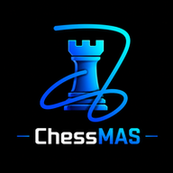

# Chess.MAS

Play chess against a seven-level bot, track your rating, and review every game — in any browser, and offline once installed. Free and open source by **MAS Studio**.

<p align="center"></p>

## Features

- **MAS Engine bot, 7 levels** — Pawn (400), Knight (700), Bishop (1000), Rook (1300), Queen (1600), King (1900) and MAS Max (2200+). Runs in a Web Worker, so the board never freezes; a watchdog guarantees the bot always moves.
- **Real chess clocks** — 1+0, 2+1, 3+0, 3+2, 5+0, 10+0, 15+10, 30+0 or untimed. Increments, low-time warning, tenths under 20 seconds, flag detection.
- **Rating** — rated games against the bot move your Elo-style rating up or down. Takebacks and hints make a game casual.
- **Game review** — accuracy for both players, every move graded Book, Best, Excellent, Good, Inaccuracy, Mistake or Blunder, best-move arrows and an evaluation graph. Opening moves from the book are marked as Book, never as Best.
- **Save as PDF** — offered at the end of every game: result, players, opening, accuracy, final position diagram and the full move list. PGN copy too.
- **4 boards and 4 piece sets** — Forest, Classic, Ocean, Midnight boards; Classic, Neo, Minimal and Pixel pieces.
- **Themes** — Auto (follows your device), Light, Dark and Retro.
- **Play a friend** on one device, with optional auto-flip.
- Drag or tap to move, premoves, takeback, hints, draw offers, resign, move navigation with the arrow keys, resume an unfinished game after a refresh.
- **Offline PWA** — installable on Android, iOS and desktop.

## Run it locally

No build step. Either open `index.html` directly, or (recommended, enables offline mode) serve the folder:

```bash
cd chess-mas
python3 -m http.server 8000
# open http://localhost:8000
```

## Publish on GitHub Pages

1. **Create the repository.** Sign in at <https://github.com/Al-Shahriar-12>, click **New**, name it `chess-mas`, keep it **Public**, and leave "Add a README" unticked. Click **Create repository**.
2. **Upload the files.** On the new repository page click **uploading an existing file**. Open the `chess-mas` folder, select **all** the files inside it (Ctrl+A / Cmd+A) and drag them in. Every file sits at the top level, so there are no sub-folders to lose. Write a message such as "Chess.MAS v3.0" and click **Commit changes**.
   - Hidden file tip: if your computer hides `.nojekyll`, it's fine to skip it; the site still works.
   - Prefer the command line? From inside the folder:
     ```bash
     git init
     git add .
     git commit -m "Chess.MAS v3.0"
     git branch -M main
     git remote add origin https://github.com/Al-Shahriar-12/chess-mas.git
     git push -u origin main
     ```
3. **Turn on Pages.** Go to **Settings → Pages**. Under **Build and deployment**, set **Source** to *Deploy from a branch*, choose **main** and **/ (root)**, then **Save**.
4. **Wait about a minute**, refresh the Pages screen, and open the link it shows:
   `https://al-shahriar-12.github.io/chess-mas/`
5. **Install it.** Open the link in Chrome on Android and tap **Install app** (or the Install button on the Chess.MAS home screen). On iPhone use Safari → Share → **Add to Home Screen**. After the first load it works offline.

### Updating later

Upload the changed files again (same names) and commit. Then open `sw.js`, bump `CACHE = 'chess-mas-v3.0.1'` to a new version (for example `v3.0.2`) and commit it too, so installed copies pick up the update.

## Project layout

```
chess-mas/                  (every file sits at the top level)
├── index.html              app shell
├── styles.css              all styles (themes, boards, layout)
├── chess.min.js            chess.js 0.12.0 — rules
├── engine.js               MAS Engine — search + evaluation (Web Worker)
├── book.js                 opening book
├── pieces.js               the 4 piece sets as SVG data
├── app.js                  board, clocks, bot, review, PDF, screens
├── logo.png, photo-*.jpg   logo and photos
├── icon-*.png              PWA icons
├── manifest.webmanifest    install metadata
├── sw.js                   offline cache
├── LICENSE                 MIT
└── CREDITS.md              third-party licenses
```

## About

Made by **MD Al Shahriar** — BSc in Civil Engineering, BUET — founder of MAS Studio (MAS = Mohammad Al Shahriar), which builds free, open-source engineering web apps for civil engineering students in Bangladesh.

- GitHub: <https://github.com/Al-Shahriar-12>
- YouTube: <https://www.youtube.com/channel/UCywFnnFoQ9N071noUAL_m8A>

## License

MIT for Chess.MAS itself. Bundled third-party work keeps its own license — see [CREDITS.md](CREDITS.md).
